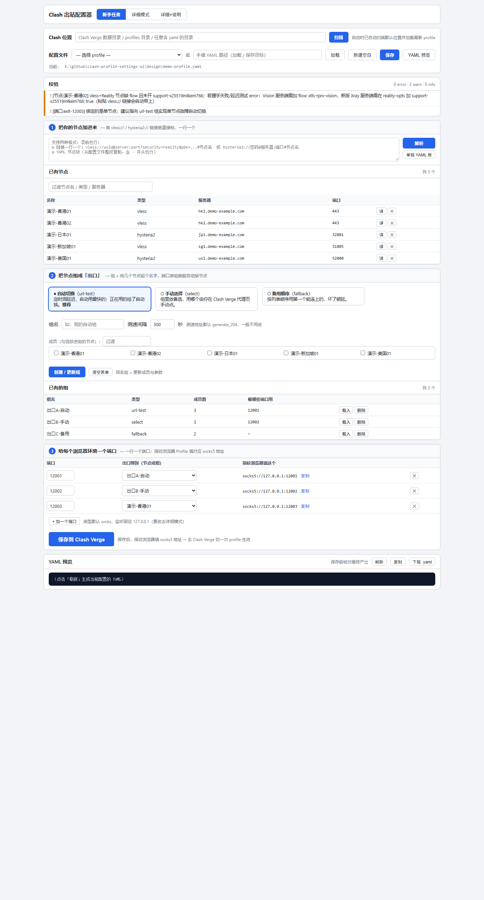
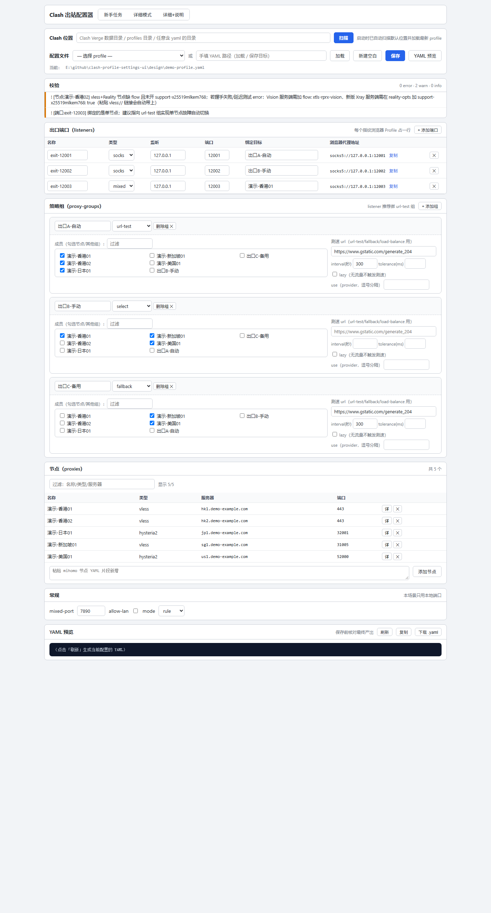

# clash-profile-settings-ui

Clash Verge Rev / mihomo 出站配置器 —— 一个**单文件 Windows 工具**，启动后打开本地网页界面，帮你把代理节点、策略组、独立出口端口（一端口一出口）配好写回 Clash 配置，专门服务**指纹浏览器多 Profile 各自走不同出口**的场景。

> A single-file Windows tool that opens a local web UI for configuring mihomo / Clash Verge Rev: add VLESS / Hysteria2 nodes, build proxy groups, bind one local port per exit — designed for fingerprint-browser multi-profile setups where each profile needs its own outbound.

## 它解决什么问题

指纹浏览器做账号矩阵时，常见需求是「每个浏览器 Profile 走一个固定、互不干扰的出口」。在 mihomo/Clash Verge Rev 里这需要手写 YAML：把节点加进 `proxies`、组 `proxy-groups`、给每个 Profile 开 `listeners` 端口并绑定出口。本工具把这些变成网页上的三步操作：

```
粘链接 → 组成「出口」→ 绑端口 → 指纹浏览器填 socks5://127.0.0.1:端口
```

| 新手任务 | 详细模式 |
|---|---|
|  |  |

## 功能特性

- **节点导入零门槛**：直接粘贴 `vless://`、`hysteria2://` / `hy2://` 分享链接，或整段 mihomo YAML 节点块（支持 `- name:` 列表项、多节点序列），解析预览后一键加入
  - VLESS Reality 参数完整映射：`pbk/sid/spx/fp/flow`，以及新版服务端必需的 `support-x25519mlkem768`
- **策略组向导**：url-test（自动测速/容灾）、select（手动）、fallback（顺序备用），勾选成员即建组，循环引用自动检测
- **独立端口出口**：`listeners` 一端口绑一节点/组，页面直接给出可复制的 `socks5://` 地址
- **自动扫描加载**：启动自动扫描 Clash Verge Rev 数据目录并加载最新 profile（自动跳过 `Merge.yaml` 等覆写模板）；也可手动指定 Clash 位置
- **YAML 保真写回**：基于 `yaml.Node` 编辑，未接管的字段（rules、订阅、注释、全局设置等）原样保留；保存前自动 `.bak` 备份
- **实时校验**：重名、悬空引用、重复端口、组循环、VLESS+Reality 参数缺失（flow / mlkem768）等即时提示并定位到区块
- **节点详情查看**：每个节点可查看完整 YAML（uuid/密钥/flow 等全部字段）并复制
- **三种模式**：新手任务（三步引导）、详细模式（全字段表格）、详细+说明（逐字段大白话解释）
- **本地安全**：仅监听 `127.0.0.1`，无任何外部请求；单文件 exe ~11MB，无需安装

## 快速开始

1. 下载或自行编译 `clash-profile-ui.exe`
2. 双击运行 —— 自动扫描 Clash Verge Rev 目录、加载最新 profile，并打开浏览器页面（默认 `http://127.0.0.1:18630`）
3. 按「新手任务」三步操作后点保存，**到 Clash Verge Rev 里把当前订阅/profile 切换一次**（或重启 CVR）让改动生效
4. 指纹浏览器各 Profile 的代理填：`socks5://127.0.0.1:<你绑的端口>`

命令行参数：

| 参数 | 说明 |
|---|---|
| `-addr 127.0.0.1:18630` | 监听地址（端口被占用时自动顺延最多 20 个） |
| `-file path\to\x.yaml` | 启动即加载指定 YAML（优先于自动扫描） |
| `-no-browser` | 不自动打开浏览器 |

详细操作见 [使用手册](docs/USER_MANUAL.md)，第一次用建议直接看 [新手指南](docs/BEGINNER_GUIDE.md)。

## 从源码构建

环境要求：Go 1.27+（仅一个外部依赖 `gopkg.in/yaml.v3`）。

```bash
git clone https://github.com/stride-ground/clash-profile-settings-ui.git
cd clash-profile-settings-ui
go mod tidy

# 本机构建（当前系统）
go build -o clash-profile-ui.exe .

# 或显式编译 Windows amd64
GOOS=windows GOARCH=amd64 go build -o clash-profile-ui.exe .
```

开发自检命令：

```bash
gofmt -l .        # 应为空
go vet ./...
go test ./...
```

项目结构：

| 文件 | 说明 |
|---|---|
| `main.go` | 入口：参数、端口监听、自动扫描预载、开浏览器 |
| `server.go` | HTTP API：state/scan/load/save/validate/preview/parse-*/node-detail |
| `mihomo.go` | YAML 保真读写 + 模型 + 校验（`yaml.Node` 级编辑） |
| `shareparse.go` | vless / hysteria2 分享链接解析（XHTTP+TLS 槽位预留） |
| `index.html` | 内嵌单页 UI（原生 JS，无前端构建链） |

## 常见问题

**节点延迟测试 error/timeout，但同一个链接在别处（指纹浏览器/Xray）能用？**

最常见原因（按真实排障排序）：

1. **新版服务端要 `support-x25519mlkem768`**：Xray ≥ 26.9.8 的 Reality 服务端强制要求 ClientHello 带后量子密钥，否则报 `REALITY authentication failed`。Xray 内核客户端自动协商；mihomo 需要在节点的 `reality-opts` 里显式加 `support-x25519mlkem768: true`。**用本工具粘贴 vless:// 链接会自动带上**。
2. **凭据/参数抄错**：`short-id`、`public-key`、`uuid`、`servername` 任一不匹配都会认证失败。用节点行的「详」按钮核对全字段，与服务商给的链接逐一对照。
3. **Vision 流控**：服务端开 Vision 时节点需 `flow: xtls-rprx-vision`；没开则不要加，保持和链接一致。

**浏览器配了端口还是上不了网？**

- 确认填的是 `socks5://127.0.0.1:<端口>` 而不是 http 代理（socks 类型 listener 只认 socks5；要两种都认，把该 listener 类型改成 `mixed`）
- 保存后必须在 Clash Verge Rev 里**切换一次 profile**（或重启 CVR）才会重新生成运行时配置
- 绑 `fallback`/`url-test` 组且组内节点全挂时出口不可用；先确保节点本身延迟测试通过

**订阅 profile 保存后节点不见了？** 机场订阅会被 CVR 定期覆盖刷新。本工具适合本地 profile；订阅场景建议用 CVR 的 Merge 覆写文件承载自定义节点。

## 支持的格式

| 格式 | 状态 |
|---|---|
| `vless://`（含 Reality + MLKEM768） | ✅ |
| `hysteria2://` / `hy2://` | ✅ |
| mihomo YAML 节点块（裸映射 / `- name:` / 多节点） | ✅ |
| `ss://` `trojan://` `vmess://` `tuic://` | ❌ 暂不支持（可用 YAML 片段添加） |
| VLESS `type=xhttp`（XHTTP+TLS CDN 回源） | 🔧 槽位已预留，本版未实现 |

## 文档

- [新手指南](docs/BEGINNER_GUIDE.md) —— 从一条 vless 链接到指纹浏览器能用，逐步走通
- [使用手册](docs/USER_MANUAL.md) —— 全部界面、字段、API 与文件行为详解
- [PRD](docs/PRD.md) · [架构](docs/ARCHITECTURE.md) · [开发](docs/DEVELOPMENT.md) · [测试计划](docs/TEST_PLAN.md)

## License

[MIT](LICENSE)
